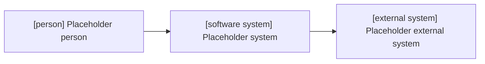
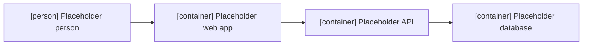
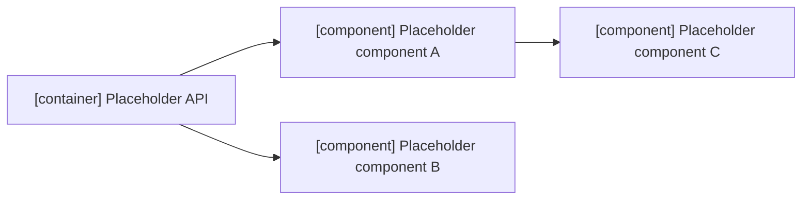

# Architecture document

C4 / arc42. Decisions: [adr.md](adr.md).

| **Owner**              |                                                                     |
|:-----------------------|---------------------------------------------------------------------|
| **Date**               |                                                                     |
| **Related Components** |                                                                     |
| **Status**             | Draft &#124; Proposal &#124; Review &#124; Accepted &#124; Rejected |

## Context

> a system context diagram [1] plus some narrative text to "set the scene"

## Functional overview
> an overview of the software system (including wireframes, UI mockups, screenshots, workflow diagrams, business process diagrams)

# Quality attributes
> non-functional requirements, such as performance, scalability, security

# Constraints
> timescales, budget, technology, team size/skills

# Principles
> a list of development and architecture principles (coding conventions, separation of concerns, patterns)

# Software architecture

> static structure (containers [2] and components [3]), dynamic runtime

# Code
> important or complicated components, implementation details, patterns, frameworks

# Data
> data models, entity relationship diagrams, security, data volumes, archiving strategies, backup strategies

# Infrastructure architecture
> description of the available infrastructure to run the system

# Deployment
> mapping the software to the infrastructure

# Development environment
> how a new developer gets started

# Operation and support
> how the software system is operated, supported, monitored

# Decision log
> a list of the major decisions made (architecture decision)

[1]: https://c4model.com/#SystemContextDiagram
[2]: https://c4model.com/#ContainerDiagram
[3]: https://c4model.com/#ComponentDiagram
[4]: https://www.infoq.com/articles/C4-architecture-model
